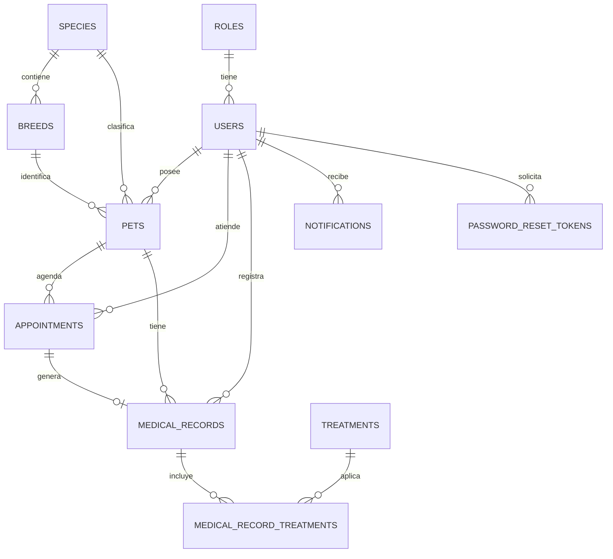

# Diagrama Entidad-Relación – VetCare

## Descripción

Base de datos relacional para la gestión
de la clinica.

## Relaciones principales

- Un rol puede tener múltiples usuarios.
- Un cliente puede registrar múltiples mascotas.
- Una mascota pertenece a una especie y una raza.
- Una mascota puede tener múltiples citas.
- Un veterinario puede atender múltiples citas.
- Una mascota puede tener múltiples expedientes médicos.
- Los expedientes médicos pueden incluir múltiples tratamientos.

## Diagrama

